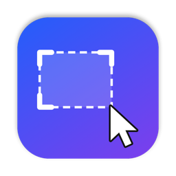
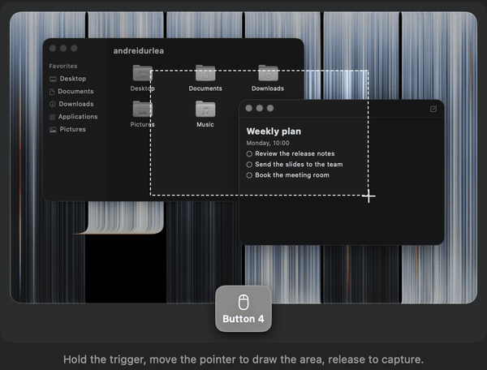

# Fast Screenshot

[](./VERSION)
[](#requirements)
[](./LICENSE)

Fast Screenshot is a macOS menu bar app that maps a key, a mouse button or a combination of them to an area screenshot. Holding the trigger opens the macOS selection crosshair at the pointer, moving the pointer draws the selection, and releasing the trigger captures it.



---

## How It Works

The app installs a session event tap and handles each trigger in four steps.

1. When the last input of the trigger goes down, it swallows the event and posts ⌃⇧⌘4 (clipboard) or ⇧⌘4 (file).
2. After the start delay, it posts a left mouse down at the pointer position.
3. While the trigger is held, it converts pointer movement into left mouse drag events.
4. When any input of the trigger is released, it posts a left mouse up, which ends the selection and captures it.

A release before step 2 sends Escape and cancels the capture. Key and mouse button events of the trigger are swallowed; modifier keys pass through. Events the app posts carry a marker in `eventSourceUserData` and pass through its own tap unchanged.

The capture uses the system screenshot shortcut for the selected target, which must be enabled with its default keys in System Settings › Keyboard › Keyboard Shortcuts › Screenshots.

---

## Requirements

- macOS 13 or later.
- Swift 5.9 or later (Xcode or the Command Line Tools) to build.
- Accessibility permission for Fast Screenshot.

---

## Installation

### From a release

1. Download `FastScreenshot-<version>.zip` from [Releases](https://github.com/AndreiDurlea/fast-screenshot-macos/releases) and unzip it.
2. Move `FastScreenshot.app` to `/Applications`. Opened from any other folder, the quarantined app runs from a temporary path and does not register its login agent.
3. Open it. macOS blocks the first launch because the app is not notarized; click Open Anyway in System Settings › Privacy & Security, then open it again.
4. Allow Accessibility and record a trigger in the onboarding window.

### From source

```bash
git clone https://github.com/AndreiDurlea/fast-screenshot-macos.git
cd fast-screenshot-macos
./scripts/build-app.sh --install
```

The script builds `build/FastScreenshot.app`, copies it to `/Applications` and opens it. Without `--install` it only builds. `scripts/make-icon.swift` regenerates `Resources/AppIcon.icns` and `docs/icon.png`.

### Login agent

On launch the app writes `~/Library/LaunchAgents/com.durlea.fastscreenshot.plist` with `RunAtLoad` and `KeepAlive`, loads it and exits; launchd then runs the agent copy at every login and restarts it within 5 seconds when it exits. The menu has no Quit item. Opening the app while it runs shows Settings. When the agent is turned off in System Settings › General › Login Items, the copy opened from Finder keeps running, and the menu and Settings show a warning that opens Login Items.

A LaunchAgent written by the app replaces `SMAppService`: with an ad-hoc signature, `SMAppService` ties the agent to the code it had at registration, and after a rebuild its spawn intermittently fails with a launch constraint violation.

The bundle is ad-hoc signed with the designated requirement `identifier "com.durlea.fastscreenshot"`, so the Accessibility grant stays valid across rebuilds.

> [!NOTE]
> The app is ad-hoc signed and not notarized, so Gatekeeper asks for Open Anyway once per download. A build made on the same Mac opens without the prompt.

---

## Onboarding

The onboarding window opens at launch until Accessibility is granted, a trigger is set and Done is pressed.

1. Allow Accessibility. The step turns green within 2 seconds of the grant. A Restart button appears 20 seconds after Open System Settings, for grants that macOS reports late.
2. Record the trigger and choose Clipboard or File.

Launching the executable with `--onboarding` opens the window again.

---

## Settings

Settings opens from the menu bar icon, or by opening the app while it runs.

| Setting | Values | Default | Effect |
| :--- | :--- | :--- | :--- |
| Enabled | on, off | on | Off passes all trigger events through. |
| Trigger | 1 or more keys and mouse buttons | Not set | Inputs held together to start a capture. |
| Save to | Clipboard, File | Clipboard | File saves where the macOS screenshot settings point. |
| Start delay | 60–500 ms, step 10 | 120 ms | Wait between the shortcut and the mouse down. |

Record collects every key, modifier and mouse button pressed until all are released, and the keycaps above show them while they are held. Esc as the first key cancels. A trigger of modifier keys only is rejected. Left and right click are accepted only together with at least one modifier, such as ⌘⌃⇧ + right click; without the modifiers held, clicks pass through unchanged. A mouse button that records nothing is handled inside the mouse and never reaches macOS; remap it in the vendor software.

The top of the window shows an animated capture over the current desktop wallpaper, with a Finder window that uses the home folder's icons and a notes window. Both follow the system appearance and accent color; the traffic lights turn grey with the Graphite accent. The trigger's keycaps sit on the bottom edge and press in step with the animation; while recording, they show the physical inputs held.

Holding ⇧ or ⌥ during the selection changes it as in the macOS crosshair (⇧ locks an axis, ⌥ resizes from the center), so triggers with ⌘ and ⌃ draw a free rectangle.

A start delay of 50 ms missed 2 of 4 captures on a MacBook Pro with macOS 26; 80 ms and above captured every time.

Settings are stored in the `com.durlea.fastscreenshot` user defaults domain.

---

## Uninstallation

```bash
launchctl bootout gui/$(id -u)/com.durlea.fastscreenshot
rm ~/Library/LaunchAgents/com.durlea.fastscreenshot.plist
rm -rf /Applications/FastScreenshot.app
defaults delete com.durlea.fastscreenshot
```

---

## License

MIT, see [LICENSE](./LICENSE).
